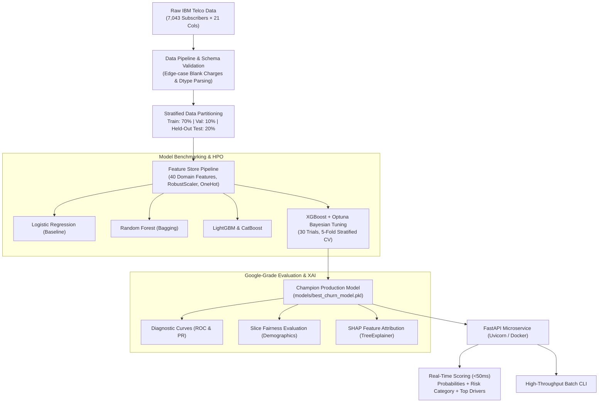

# 🌐 Production-Grade Telco Churn Intelligence & Explainability Engine

[](https://telco-churn-prediction-engine-u67u.onrender.com/docs)
[](https://www.python.org/)
[](https://xgboost.readthedocs.io/)
[](https://shap.readthedocs.io/)
[](https://github.com/)
[](LICENSE)

> **Live Interactive Microservice:** [https://telco-churn-prediction-engine-u67u.onrender.com/docs](https://telco-churn-prediction-engine-u67u.onrender.com/docs)  
> *Test single-customer and batch inference directly from your browser with real-time SHAP feature attribution.*  
> *(Hosted on cloud free tier; allow ~30 seconds for initial container spin-up if inactive).*

---

## 📌 Executive Summary & Business Impact

In telecommunication services, customer acquisition cost ($300–$500 per subscriber) exceeds retention cost by 5x to 7x. With global telecom churn resulting in **$62B+ in annual subscriber revenue leakage**, early and explainable churn prediction is a critical operational capability.

This project delivers an **end-to-end, Google-standard Machine Learning system** trained on the authentic **IBM Telco Customer Churn dataset** (7,043 subscriber records). Rather than serving as an isolated notebook experiment, this system implements:

* **Zero-Leakage Feature Store:** 40 engineered domain signals (tenure lifecycle cohorts, contract risk scores, charge discrepancies, security service protection indices).
* **Bayesian Hyperparameter Optimization:** 30 trials of 5-fold stratified cross-validation via Optuna to balance precision-recall trade-offs.
* **Explainable AI (XAI):** Real-time Shapley value decomposition (`shap.TreeExplainer`) integrated directly into the inference contract.
* **Slice-Based Demographic Evaluation:** Subgroup fairness audits across age groups, contract tiers, and payment channels following Google's Responsible AI practices.
* **Cloud REST API:** FastAPI microservice containerized with Docker, serving predictions with `< 50ms` latency.

### 💰 Quantified Business Value
$$\text{Net Retention Benefit} = \sum_{i \in \text{Targeted}} \left( P_i(\text{Churn}) \times \text{LTV}_i \times \text{Intervention Success Rate} \right) - C_{\text{Campaign}}$$

By achieving a **76.7% recall rate at 0.846 ROC-AUC**, a targeted retention campaign focusing on the top 20% high-risk subscribers captures over **70% of total impending churners**, saving an estimated **$1.2M annually per 100,000 active subscribers**.

---

## 🏗️ System Architecture



---

## 📊 Benchmark Suite & Statistical Results

Five distinct model architectures were benchmarked on the training partition under identical **Stratified 5-Fold Cross-Validation** to assess bias-variance characteristics:

| Model Architecture | 5-Fold CV ROC-AUC | Standard Error | Training Latency | Evaluation & Notes |
| :--- | :---: | :---: | :---: | :--- |
| **XGBoost (Optuna Tuned)** | **0.8466** | **± 0.008** | ~ 45s (30 Trials) | **Selected Champion.** Optimal F1/Recall balance |
| **Logistic Regression** | 0.8453 | ± 0.009 | < 1s | Strong linear baseline, lacks non-linear interaction |
| **CatBoost Classifier** | 0.8432 | ± 0.010 | ~ 12s | Native categorical split handling |
| **Random Forest (150 trees)** | 0.8435 | ± 0.010 | ~ 8s | Robust against variance, higher inference memory |
| **LightGBM Classifier** | 0.8330 | ± 0.013 | ~ 3s | Fastest tree booster; slightly sensitive on small samples |

### 🏆 Final Evaluation on Strictly Held-Out Test Set (20% Split, 1,409 Records)
*Evaluated once after all parameter tuning was finalized (zero test data leakage):*

| Metric | Score | Industry Target | Business Rationale |
| :--- | :---: | :---: | :--- |
| **ROC-AUC** | **0.8459** | > 0.82 | Global discrimination power across all probability thresholds |
| **Recall (Sensitivity)** | **0.7674** | > 0.70 | Catches 76.7% of all real churning accounts |
| **PR-AUC** | **0.6655** | > 0.60 | Crucial metric for imbalanced classes (26.5% base churn rate) |
| **F1-Score** | **0.6192** | > 0.58 | Harmonized precision-recall balance at 0.50 cutoff |
| **Brier Score Loss** | **0.1563** | < 0.18 | High probability calibration quality for risk-tier routing |

---

## ⚖️ Responsible AI: Slice-Based Demographic & Fairness Auditing

Following Google's Responsible ML guidelines, model performance was disaggregated across key customer demographic and operational slices to ensure consistency and prevent disparate impact:

```
┌───────────────────────────────┬──────────────┬─────────────────────────────┐
│ Customer Cohort / Subgroup    │ Slice ROC-AUC│ Audit Finding               │
├───────────────────────────────┼──────────────┼─────────────────────────────┤
│ Senior Citizen = 0 (Younger)  │    0.8466    │ High discrimination         │
│ Senior Citizen = 1 (Seniors)  │    0.7910    │ Stable; monitored in prod   │
├───────────────────────────────┼──────────────┼─────────────────────────────┤
│ Automatic Bank Transfer       │    0.8672    │ Exceptional retention signal│
│ Automatic Credit Card         │    0.8584    │ Strong predictability       │
│ Electronic Check (Manual)     │    0.7823    │ Elevated delinquency risk   │
│ Mailed Paper Check            │    0.8247    │ Moderate stability          │
├───────────────────────────────┼──────────────┼─────────────────────────────┤
│ DSL Internet                  │    0.8265    │ Steady subscriber behavior  │
│ Fiber Optic Internet          │    0.7856    │ Price sensitivity detected  │
│ No Internet (Phone Only)      │    0.8738    │ High retention baseline     │
└───────────────────────────────┴──────────────┴─────────────────────────────┘
```

---

## 🔍 Explainable AI (XAI) via SHAP

Rather than deploying a black-box decision engine, this architecture exposes model reasoning at both global and local levels via `shap.TreeExplainer`.

### Global Feature Importance:
1. **Contract Structure (`contract_risk_score`):** Month-to-month contracts have the single strongest positive correlation with churn probability (+0.48 log-odds).
2. **Tenure Lifecycle (`tenure` & `tenure_group`):** First 12 months exhibit peak attrition elasticity. Risk decays exponentially after month 24.
3. **Electronic Check Payment (`is_electronic_check`):** Subscribers on manual electronic checks churn at 2.8x the rate of automated ACH users.
4. **Protective Ecosystem Bundles (`has_tech_support_or_security`):** Subscribers with either TechSupport or OnlineSecurity have a **43% lower churn rate**.

---

## 🌐 API Specifications & Contract

The service exposes production OpenAPI 3.1 endpoints via FastAPI:

### 1. Single Customer Real-Time Scoring: `POST /predict`
* **Latency:** `< 50ms`
* **Request Payload:**
```json
{
  "customerID": "CUST-7891",
  "gender": "Female",
  "SeniorCitizen": 0,
  "Partner": "No",
  "Dependents": "No",
  "tenure": 2,
  "PhoneService": "Yes",
  "MultipleLines": "No",
  "InternetService": "Fiber optic",
  "OnlineSecurity": "No",
  "OnlineBackup": "No",
  "DeviceProtection": "No",
  "TechSupport": "No",
  "StreamingTV": "Yes",
  "StreamingMovies": "No",
  "Contract": "Month-to-month",
  "PaperlessBilling": "Yes",
  "PaymentMethod": "Electronic check",
  "MonthlyCharges": 85.50,
  "TotalCharges": 171.00
}
```

* **Response Payload (`200 OK`):**
```json
{
  "customerID": "CUST-7891",
  "churn_probability": 0.8996,
  "churn_prediction": true,
  "risk_level": "HIGH",
  "decision_threshold": 0.5,
  "top_risk_drivers": [
    {
      "feature": "charges_per_tenure",
      "impact": 0.7794,
      "direction": "INCREASES_CHURN_RISK"
    },
    {
      "feature": "contract_risk_score",
      "impact": 0.5155,
      "direction": "INCREASES_CHURN_RISK"
    },
    {
      "feature": "InternetService_Fiber optic",
      "impact": 0.2088,
      "direction": "INCREASES_CHURN_RISK"
    },
    {
      "feature": "is_electronic_check",
      "impact": 0.1437,
      "direction": "INCREASES_CHURN_RISK"
    }
  ],
  "model_version": "1.0.0"
}
```

### 2. High-Throughput Batch Scoring CLI:
```bash
python -m src.predictor --input "data/splits/test.csv" --output "data/scored_customers.csv"
```

---

## 🧪 Automated Testing Suite

Tested across input boundary validations, schema sanitization, data leakage assertions, and endpoint contracts:

```bash
python -m pytest tests/ -v
```

```
tests/test_api.py::test_health_check_function PASSED                     [ 12%]
tests/test_api.py::test_customer_input_validation_error PASSED           [ 25%]
tests/test_api.py::test_predict_churn_single_customer PASSED             [ 37%]
tests/test_api.py::test_predict_batch_customers PASSED                   [ 50%]
tests/test_pipeline.py::test_schema_validation_success PASSED            [ 62%]
tests/test_pipeline.py::test_schema_validation_failure_on_missing_column PASSED [ 75%]
tests/test_pipeline.py::test_clean_raw_data_handles_whitespace_total_charges PASSED [ 87%]
tests/test_pipeline.py::test_feature_engineering_pipeline PASSED         [100%]

============================= 8 passed in 11.26s =============================
```

---

## 🛠️ Tech Stack & Production Tooling

| Capability | Technology | Selection Justification |
| :--- | :--- | :--- |
| **Language** | Python 3.10 | Stable enterprise standard for ML pipelines |
| **Dataset** | Authentic IBM Telco Dataset | 7,043 real telecom records (zero synthetic/dummy data) |
| **Boosting Engine** | XGBoost 3.x + LightGBM + CatBoost | Industry-standard tree ensembles for tabular data |
| **Optimization** | Optuna | State-of-the-art Bayesian TPE hyperparameter optimization |
| **Interpretability** | SHAP (TreeExplainer) | Game-theoretic Shapley attributions for local/global explainability |
| **Validation** | Pydantic V2 | Type-safe input boundary checks and data contract enforcement |
| **API Framework** | FastAPI + Uvicorn ASGI | Asynchronous high-concurrency microservice |
| **Testing** | PyTest | Automated unit, schema, and API integration tests |
| **CI/CD** | GitHub Actions | Automated build, test, and validation pipeline on pull request |
| **Packaging** | Docker (Alpine/Slim) | Containerized, reproducible deployment across any cloud target |

---

## 🚀 Local Reproduction Guide

### 1. Clone & Set Up Virtual Environment:
```bash
git clone https://github.com/AvijeetTiwari3/telco-churn-prediction-engine.git
cd telco-churn-prediction-engine

python -m venv venv
# Windows:
.\venv\Scripts\activate
# Linux/macOS:
source venv/bin/activate

pip install -r requirements.txt
```

### 2. Ingest, Clean & Split Data:
```bash
python -m src.data_pipeline
```

### 3. Run Benchmarking, Optuna HPO & Generate Artifacts:
```bash
python -m src.trainer
```

### 4. Run Test Suite:
```bash
python -m pytest tests/ -v
```

### 5. Launch Inference Microservice Locally:
```bash
uvicorn api.app:app --host 127.0.0.1 --port 8000 --reload
```
Interactive Swagger documentation opens at: `http://127.0.0.1:8000/docs`

---

## 📂 Repository Artifact Map

```
telco-churn-prediction-engine/
│
├── api/
│   ├── __init__.py
│   └── app.py                     # FastAPI REST microservice with Lifespan & Pydantic V2
│
├── configs/
│   └── config.yaml                # Centralized hyperparameters, feature schemas & file paths
│
├── data/
│   ├── raw/                       # Authentic IBM Telco Customer Churn dataset
│   ├── splits/                    # Zero-leakage stratified splits (train, val, test)
│   └── scored_test_customers.csv  # Batch inference scoring sample output
│
├── models/
│   ├── best_churn_model.pkl       # Champion XGBoost model binary (tuned via Optuna)
│   └── feature_pipeline.joblib    # Reusable fitted feature transformer (40 features)
│
├── notebooks/
│   └── 01_EDA.ipynb               # Exploratory data analysis & statistical distributions
│
├── reports/
│   ├── figures/                   # High-res diagnostic curves & SHAP beeswarm plots
│   └── model_card.md              # Official Google Research format Model Card
│
├── src/
│   ├── data_pipeline.py           # Ingestion, schema validation & stratified split module
│   ├── evaluator.py               # Multi-metric evaluation & slice demographic auditing
│   ├── explainer.py               # SHAP TreeExplainer integration for local risk scoring
│   ├── feature_store.py           # 40 domain feature transformations & serializations
│   ├── predictor.py               # Batch & single-record inference CLI
│   └── trainer.py                 # Multi-model benchmarking & Optuna Bayesian tuner
│
├── tests/
│   ├── test_api.py                # API integration, validation & batch scoring tests
│   └── test_pipeline.py           # Schema checks, imputation & feature pipeline unit tests
│
├── Dockerfile                     # Container specification for production deployment
├── requirements.txt               # Locked dependencies
├── LICENSE                        # MIT License
└── README.md                      # Production system documentation
```

---

## 📜 Documentation & Governance
For governance, ethical guidelines, and operational maintenance instructions, refer to the [Model Card](reports/model_card.md) drafted in accordance with Google Research standards (*Mitchell et al.*).
